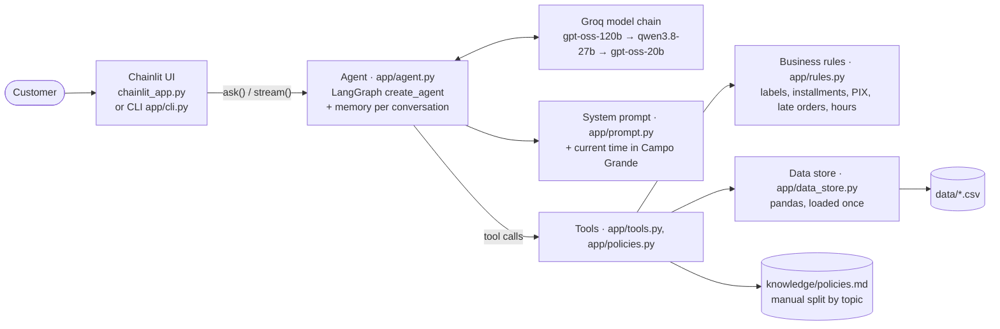

# Empório da Música · customer service agent

A text chat agent that answers the customers of **Empório da Música**, a (fictional) musical instrument store in Campo Grande/MS, Brazil. It talks to customers in Brazilian Portuguese and looks up real store data before it answers: prices, availability, promotions, payment options, order status and store policies.

Built with **Python 3.12**, **LangGraph**, **Groq** (free tier) and **Chainlit**.

- [Overview](#overview)
- [How to run](#how-to-run)
- [Example conversations](#example-conversations)
- [Architecture](#architecture)
- [Technical decisions](#technical-decisions)
- [Assumptions and data inconsistencies](#assumptions-and-data-inconsistencies)
- [Known limitations and next steps](#known-limitations-and-next-steps)
- [AI coding assistant usage](#ai-coding-assistant-usage)

---

## Overview

The store team spends most of its day on the same questions: opening hours, order status, price and availability. This agent handles them, and hands the customer over to the team when a human is needed.

**What the agent does**

- **Answers from data, never from memory.** Prices, stock, promotions and orders come only from `data/*.csv`, through tools. Store rules come only from the policy manual, through a tool. If a tool does not return something, the agent says it does not know.
- **Knows which source to use.** Product, promotion and order questions go to the data tools. Questions about rules (returns, shipping, payment, warranty, hours, privacy) go to the policy tool.
- **Applies the business rules in code.** Installments, the PIX discount and promotions are calculated by a tool, not by the model. Availability is shown only as a label, never as a stock count.
- **Protects customer data.** It looks up an order by its number only, and never returns the customer's name, phone, e-mail or address.
- **Knows its limits.** It says what it cannot do (it only reads data), politely declines accessories (the store sells instruments only) and off-topic questions, and points to the team's channels and opening hours. It knows the current time in Campo Grande, so it can say if the store is open right now.
- **Shows its work.** In the chat UI, every answer has a "Detalhes desta resposta" panel with the tools it called, the filters it used and the data sources.

---

## How to run

### 1. What you need

- **Python 3.12** ([python.org](https://www.python.org/downloads/)).
- **A free Groq API key.** Create an account at [console.groq.com/keys](https://console.groq.com/keys) and click *Create API Key*. No credit card is needed.

### 2. Install

**Windows (PowerShell)**

```powershell
git clone <repository-url>
cd emporio-agent
py -3.12 -m venv .venv
.venv\Scripts\Activate.ps1
pip install -r requirements.txt
copy .env.example .env
```

If PowerShell blocks `Activate.ps1`, run `Set-ExecutionPolicy -Scope Process -ExecutionPolicy Bypass` first. This only affects the current window.

**Linux / macOS**

```bash
git clone <repository-url>
cd emporio-agent
python3.12 -m venv .venv
source .venv/bin/activate
pip install -r requirements.txt
cp .env.example .env
```

### 3. Configure

Open `.env` and paste your key after `GROQ_API_KEY=`. Leave the other values as they are.

| Variable | Default | What it does |
|---|---|---|
| `GROQ_API_KEY` | *(empty)* | Your Groq key. Required. |
| `GROQ_MODEL` | `openai/gpt-oss-120b` | The main model. |
| `GROQ_FALLBACK_MODELS` | `qwen/qwen3.8-27b,openai/gpt-oss-20b` | Models tried in order when the main model fails, for example when its free daily quota runs out (see [D2](#d2--model-and-provider)). |

`.env` is git-ignored. Never commit it.

### 4. Run

| What | Command | |
|---|---|---|
| **Chat UI** (main interface) | `chainlit run chainlit_app.py` | Open http://localhost:8000. The home screen has six sample questions to start with. |
| **Terminal chat** (quick tests) | `python -m app.cli` | Type `sair` to quit. On Windows, use Windows Terminal: the old console breaks accents. |
| **Tests** | `pytest` | 55 tests, no API key needed: they never call the LLM. |

Errors go to `emporio.log` (CLI) or to the terminal (Chainlit). The customer only ever sees a friendly message.

### Troubleshooting

- **"Opa, tive um problema técnico..."**: usually the free quota. Each Groq model allows about 200K tokens per day, and one question uses 2–3 model calls. The agent moves on to the fallback models by itself; if all three are used up, wait a few minutes (the daily window frees up gradually) or use another Groq account.
- **A model was retired by Groq**: list the current ones at [console.groq.com/docs/models](https://console.groq.com/docs/models) and change `GROQ_MODEL` or `GROQ_FALLBACK_MODELS` in `.env`. No code change is needed.

---

## Example conversations

Five real conversations, recorded in the Chainlit UI. They are in Portuguese, as the agent really answered. Each file starts with an English summary: the scenario, the tools called and the rules applied.

| File | Scenario | Shows |
|---|---|---|
| [01_product_price.md](examples/01_product_price.md) | Price of the Takamine GD20, then 10 installments, then PIX | Data lookup, payment rules, conversation memory |
| [02_catalog_filter.md](examples/02_catalog_filter.md) | Acoustic guitars up to R$1,000, then an out-of-stock model | Filters, "showing 10 of 12", alternatives for an unavailable product |
| [03_return_policy.md](examples/03_return_policy.md) | "I regret my purchase, can I return it?" | Policy lookup, honesty about what the agent cannot do |
| [04_late_order.md](examples/04_late_order.md) | An order whose delivery date has passed | Live data + handover rule, no personal data, store hours |
| [05_store_info_and_limits.md](examples/05_store_info_and_limits.md) | Address and hours, guitar strings, a football question | Store info, out-of-scope handling, and one wording slip we kept on purpose |

---

## Architecture



**One question, step by step**

1. The UI sends the message and a conversation id (`thread_id`) to `app/agent.py`. The interfaces never call the model or the tools directly.
2. The agent builds the system prompt, adds the current date, time and store status for Campo Grande, and calls the model with the conversation history.
3. The model decides which tools to call. Each tool returns structured data, never a ready-made answer.
4. The model writes the answer in Portuguese from that data. The Chainlit UI streams it and shows the tool calls in the "Detalhes desta resposta" panel.

**Layers**

| Layer | File | Job |
|---|---|---|
| Interfaces | `chainlit_app.py`, `app/cli.py` | Chat only. No business rules. |
| Agent | `app/agent.py`, `app/prompt.py`, `app/config.py` | Model chain, prompt, memory, and friendly errors. |
| Tools | `app/tools.py`, `app/policies.py` | What the model can ask for, and exactly what it gets back. |
| Rules | `app/rules.py` | Pure functions, easy to test: availability label, payment options, late order check, opening hours. |
| Data | `app/data_store.py`, `data/`, `knowledge/` | Reads the CSVs once and joins products, categories and promotions. |

**Tools**

| Tool | Answers | Notes |
|---|---|---|
| `search_products(query, category, max_price, only_available)` | Prices, availability, product options | At most 10 products plus `total_found`. Promotions with original price, percent and final price. Never the stock count. |
| `get_active_promotions()` | "What promotions do you have?" | Only promotions marked active. |
| `get_payment_options(price_brl, is_promotional)` | PIX, debit, boleto, installments | Applies the manual's installment bands and the "PIX discount does not stack with promotions" rule. |
| `get_order_status(order_id)` | Order status, items, tracking code, delivery date | No customer data. Returns `needs_human: true` when the delivery date has passed. |
| `get_store_policy(topic)` | Store rules and info | One of 9 fixed topics: `sobre_a_loja`, `contato`, `horarios`, `pagamento`, `trocas_devolucoes`, `frete_entregas`, `promocoes`, `garantia`, `privacidade`. |

**Prompt strategy**

- **The system prompt holds the "how", the tools hold the "what".** The prompt (`app/prompt.py`, in Portuguese) defines the persona and tone, the service flow and the answer format, plus 12 rules the agent never breaks: no price, stock, promotion or deadline without a tool, a label instead of a stock count, how to apply promotions, how to refuse accessories and off-topic questions, when to hand over to the team, and never ask for or show personal data. It holds no store facts, so the data cannot go stale inside the prompt.
- **The prompt adds the current time on every model call** (`dynamic_prompt` middleware), so "are you open now?" and "when does the team reply?" are answered from the Campo Grande clock.
- **The tool descriptions do the routing.** `get_store_policy` lists example questions for each topic, which helps the model pick the right section.
- **Tool results are built for the model.** Labels are already in Portuguese, the promotional price is already calculated, missing values become `null` instead of `NaN`, and a wrong category returns the list of valid ones so that the model can try again.
- **Guard rails in code, not only in words.** Low temperature (0.2), at most 12 model or tool steps per question, and every error becomes a friendly message with the team's contacts.

**Project layout**

```
app/            agent, prompt, tools, rules, data store, config, CLI
data/           the store's CSVs and the original policy manual (PDF)
knowledge/      policies.md: the manual, split by topic and reviewed by hand
examples/       5 example conversations + screenshots
public/         Chainlit theme, logo, avatar and the "Detalhes desta resposta" panel
scripts/        one-off PDF → markdown extraction of the manual
tests/          pytest, no LLM calls
```

---

## Technical decisions

Each decision was written down before coding, as context → options → decision → reasons → what was discarded. They are numbered D1–D11 and referenced in the code comments.

### D1 · Agent framework

- **Choice:** LangGraph's prebuilt agent (`create_agent`), used only in the core (`app/agent.py`).
- **Why:** a tool-calling loop, conversation memory and middleware (dynamic prompt, model fallback) come ready, with very little orchestration code. It is also the framework named in the job description.


### D2 · Model and provider

- **Choice:** **Groq only, with a chain of models**: `openai/gpt-oss-120b`, then `qwen/qwen3.8-27b`, then `openai/gpt-oss-20b`. If a model fails (usually a 429 "too many requests"), the next one answers. Each model first retries once, which covers the per-minute limit; the last model retries twice.
- **Why:** the evaluator should be able to run the agent for free, with one key. On Groq's free tier, **each model has its own quota** (8K tokens per minute and about 200K tokens per day), so three models give three independent quotas with one key. The models' internal reasoning is hidden (`reasoning_format="hidden"`), and the log records which model answered each turn.
- **How it evolved** (decided from measurements, not guesses):
  1. *Plan:* Gemini Flash as the default, Groq as the alternative.
  2. *Revision 1:* for new accounts, `gemini-2.5-flash` returned 404, newer Flash models often returned 503 (overloaded), and the free tier allowed 5 requests per minute and 20 per day, while one question needs 2–3 model calls. Groq became the default and Gemini the automatic fallback.
  3. *Revision 2:* while recording the example conversations, both providers ran out on the same day. Gemini's 20 daily requests were gone, and so were the 200K daily tokens of `gpt-oss-120b`. A fallback that fails at the same time does not help. Gemini was removed, along with one dependency (`langchain-google-genai`), and replaced by the chain of Groq models. Before the switch, the fallback models were tested with the real prompt: they called the right tool and declined off-topic questions.

### D3 · How the agent reads the store policies

- **Choice:** a tool, `get_store_policy(topic)`, that returns one section of the manual. The PDF was converted to markdown by `scripts/extract_policies.py`, then reviewed by hand and split into 9 fixed topics (`knowledge/policies.md`).
- **Why:** the challenge evaluates whether the agent knows *when* to consult the policies. With a tool, that decision is visible and explainable, and it shows up in the UI panel. It also sends only the section needed, which saves tokens on a free tier, and it follows the same pattern as the data tools.

### D4 · How the agent reads the data

- **Choice:** the 6 CSVs (about 190 rows) are loaded once with pandas, and the model reaches them only through specific tools.
- **Why:** customer service has a well-defined scope. Specific tools control exactly what goes back to the model: the promotional price already calculated, the label instead of the stock count, no personal data. They are predictable and tested with pytest without calling the LLM.

### D5 · Interface

- **Choice:** Chainlit as the main interface, with the store's own look (name, colours, logo, avatar, light and dark themes, Portuguese labels, six sample questions), plus a minimal terminal chat as plan B. The "Detalhes desta resposta" panel under each answer is a small custom React element (`public/elements/HowIGotHere.jsx`).
- **Why:** Chainlit is built for LLM chats: streaming, starters and themes come ready, so most of the reference prototype costs little code. The panel makes the agent's data and policy lookups visible, which is one of the challenge's criteria. The interface stays separate from the agent core.

### D6 · Conversation history

- **Choice:** memory per conversation, in RAM (LangGraph `MemorySaver`). In Chainlit, one browser session is one conversation (`thread_id` = session id); the CLI starts a new conversation on every run.
- **Why:** in customer service, what matters is context *within* the conversation ("and in 10 installments?" right after asking a price), which this gives in a few lines.
- **Discarded for now:** disk persistence with `SqliteSaver` (only helps after a server restart, and without a sidebar the customer cannot reopen an old chat anyway); full chat history in a sidebar (needs user login and Chainlit's data layer, and login is odd for a store chat).

### D7 · Languages

- **Choice:** the agent speaks Brazilian Portuguese. Code, comments, commits and this README are in English. The example conversations are in Portuguese, with an English summary at the top of each file.
- **Why:** the agent must speak the customers' language, and the evaluation is in English. Translating the conversations would hide the agent's real behaviour.

### D8 · Data and manual inconsistencies

Crossing the manual with the CSVs revealed 8 ambiguous or conflicting points. Each was resolved with a conservative interpretation, listed in [Assumptions and data inconsistencies](#assumptions-and-data-inconsistencies). Corrections to the manual are marked "Interpretação documentada" inside `knowledge/policies.md`, and the system prompt tells the model to apply them without quoting the note to the customer.

### D9 · Order lookup and privacy

- **Choice:** orders are looked up by their number only. `get_order_status` returns status, items, total, payment method, tracking code and delivery estimate, and never the customer's name, phone, e-mail or city. The `customers` table is never sent to the model.
- **Why:** simpler for the customer, and the exposure is limited to non-personal information (the manual has an LGPD section, §9).
- **Discarded:** asking for the order number plus e-mail or phone (see [Known limitations](#known-limitations-and-next-steps)).

### D10 · Python environment

- **Choice:** Python 3.12, `venv`, and `requirements.txt` with pinned versions. Commands are given for Windows (PowerShell) and Linux/macOS.
- **Why:** the path with the least friction for an evaluator on an unknown system, with no extra tool to learn.
- **Discarded:** uv and Poetry (faster or nicer, but one more thing to install and learn).

### D11 · Testing strategy

- **Choice:** pytest on everything deterministic (tools, rules, data store, policies, UI panel, agent error handling) with **no LLM calls**, plus a fixed list of manual acceptance scenarios for the agent's behaviour.
- **Why:** the biggest risk of a silent error is in the business rules, and pytest covers them fast and for free: availability labels, status over stock, promotional price, PIX that does not stack with promotions, no personal data in orders, store hours, the fallback chain. The agent's behaviour depends on the LLM, varies between runs and spends free quota, so it was checked by hand: 12 acceptance scenarios, which led to tool and prompt fixes (commit `0b26a7e`) and to the example conversations.
- **Discarded for now:** automated LLM scenarios in CI (cost and quota). See next steps.

---

## Assumptions and data inconsistencies

**About the manual**

1. **Contact numbers.** The manual lists two numbers. Both are treated as valid, and the agent gives both: (67) 3341-4444 (general phone/WhatsApp) and (67) 3321-4500 (customer service WhatsApp, §7).
2. **E-mail.** Table 1.2 writes the e-mail with an accent ("empóriodamusica"). The version without the accent, from the manual's cover, is used: contato@emporiodamusica.com.br.
3. **Installments.** The payment table says "minimum installment R$100", while §3.1 gives bands. The bands are followed, since they detail the rule. The band "up to 3x, no minimum, except below R$50" is read as a R$50 minimum. In case of doubt, the agent refers the customer to the team (§10).
4. **Catalog size and stock.** The agent may say the store has "more than 300 instruments" (institutional positioning), but it only offers what the system shows (§7.1). It never gives a stock count. `search_products` returns a label built from status and stock:

   | Status | Stock | Label shown |
   |---|---|---|
   | active | more than 3 | disponível |
   | active | 1 to 3 | últimas unidades |
   | active | 0 | indisponível no momento |
   | coming_soon | any | em breve |
   | discontinued | any | fora de linha |

   The limit of 3 units for "últimas unidades" is our assumption.

**About the data**

5. **Discontinued product with stock** (Ibanez Bass 2X): the status wins. The agent says it is discontinued and suggests alternatives. Selling the remaining units is a management decision.
6. **"Coming soon" product with stock** (Kala Baritone): treated as "em breve", not yet for sale. The status is the commercial lifecycle field, the units may be reserved, and §7.1 forbids confirming availability without certainty. The delivered pre-sale order stays visible in the order lookup.
7. **Active product with zero stock** (Giannini GF-3D): "indisponível no momento", plus similar alternatives (§7.3). See [example 02](examples/02_catalog_filter.md).
8. **Orders past their delivery date.** The CSVs are the current picture of the system, so the status is reported as it is. If the delivery date has passed and the order was not delivered, the agent does not invent a reason, and it refers the customer to the team (`needs_human`). See [example 04](examples/04_late_order.md).

**Other assumptions**

- **Unknown or broken data** (a status outside the known list, an empty or negative stock): the app does not crash. The label tells the customer to contact the team, and a warning is logged.
- **Several active promotions on one product:** promotions do not stack (§6.2). All are kept, most recent first. The CSV has no date, so the highest `promotion_id` counts as the most recent. The agent presents the first one, mentions the others, and lets the customer choose.
- **PIX discount** (5%) applies only to full-price products (§6.2).
- **Holidays:** the store closes on holidays, but the data has no holiday calendar, so the "open now" status only knows weekdays and hours.
- **"Today" is the real date.** Late orders are judged against the real current date, since the CSVs are treated as the live system.

---

## Known limitations and next steps

| Limitation | What we would do with more time |
|---|---|
| **Free-tier limits** (D2). About 200K tokens per day per Groq model, and one question uses 2–3 model calls. When a model's quota is nearly used up, an answer can take up to ~1 minute before the next model takes over, and the fallback models are smaller. The switch is silent for the customer (it only shows in the log). | A paid tier for production; cache answers to frequent questions (hours, address); show a "still thinking" message during long waits. |
| **The agent's behaviour is tested by hand** (D11). | An automated evaluation: a fixed set of questions, checking which tool was called with which arguments, and LLM-as-judge checks for tone and rules. Run it before every prompt change. |
| **Free text can still drift.** Numbers come from tools, but the model writes the sentences around them. Seen in testing: in one run, the model wrote "showing 12 of 12" under a table of 10 products (example 02 was recorded again); in example 05, it offered a "new or used" guitar, although the store sells only new instruments. | Return the shown count from `search_products` so the model never counts; add "new instruments only" to the prompt; add both cases to the automated evaluation. |
| **No chat history after a restart, and no list of past chats** (D6). Memory lives in RAM. | `SqliteSaver` for persistence; a history sidebar with customer identification. |
| **The policy tool fits an 8-page manual** (D3). | If the manual grows into many documents: RAG with embeddings over the sections, keeping the tool interface. |
| **No holiday calendar.** | A holiday list from the store, used by the "open now" check. |
| **Contacts in two places.** The team's phone numbers live in `knowledge/policies.md` and in `app/rules.py` (used in error messages). | One source for both. |
| **Data is read once at startup.** CSV changes need a restart. | A real database, or reloading when files change. |

---

## AI coding assistant usage

The project was built with **Claude Code** (Anthropic, running in VS Code) as a pair programmer, in an **XP-style pairing**: I (Rinmarys) worked as the architect and reviewer, and Claude worked as the senior developer.

**Who did what**

- **I decided:** the scope, every technical decision (D1–D11), the interpretations of the inconsistencies (D8), the task plan, the acceptance scenarios, which example conversations to keep, and every commit.
- **Claude implemented** one task at a time, in small steps, with tests, and stopped for review before moving on. When something went against a decision, Claude raised it as a question instead of choosing quietly.

**How the work was organised**

1. **Decision board before code.** Each decision was written down in Notion as context → options → decision → reasons → what was discarded. Claude helped list the options and the trade-offs; I chose.
2. **Trello board for the plan.** A basic Trello board (Decision → Backlog → In progress → Peer review → Done) guided the work: one card per decision (D1–D11) and one card per task (T00–T16). Each task card had a goal, the decisions it depends on, an estimate, the files involved, a "done when" criterion and the commit message. This is why the git history goes one commit per task. (https://trello.com/b/HwYC47Fv/desafio-tecnico-engenheiro-de-ia)
3. **Review loop.** I read the code Claude delivered, and used the Ponytail extension to find possible redundancies in it. After an implementation, I also asked Claude for a structured code review of the diff (bugs, risks, missing tests, extra code), then chose which findings to fix.
4. **Persistent memory.** Claude kept short notes between sessions (roles, decisions taken, measured limits), so a new session did not start from zero.

**Where the workflow paid off, and where it needed a human**

- **Acceptance testing found real issues.** The 12 manual scenarios (T10) caught a product searched in the wrong category, the agent promising "I'll forward your case" (it can't), and an accessory being offered. Each was fixed in the tool or the prompt, with a test where possible.
- **Measuring instead of guessing.** When the free quota ran out, Claude's first diagnosis was the per-minute limit, and it was wrong: the next error log showed a 429 on the very first call of a question. Calling the Groq API directly showed the real cause, the *daily* token limit, and that finding drove the D2 revision.
- **Reviews caught weak tests.** One review found that a new test still passed with the fix removed. We rewrote it, and confirmed that it fails when the fix is reverted.
- **Facts checked by hand.** Before writing the example files, every price, date and policy line in the screenshots was checked against the CSVs and the manual.
