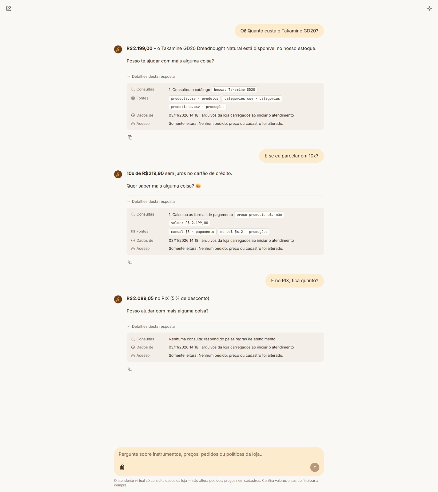

# 01 · Product price, installments and PIX

| | |
|---|---|
| **Scenario** | A customer asks the price of a specific guitar, then asks about 10 installments and paying by PIX, without repeating the product name. |
| **Tools used** | `search_products(query="Takamine GD20")` → `get_payment_options(price_brl=2199.0, is_promotional=false)` → none (the PIX price was already in the previous tool result) |
| **Rules applied** | Price and availability only from the catalog, never from memory (manual §7.1). Availability is a label, never a stock count (D8-4b). Installments and PIX are calculated by a tool, not by the model: 10x is allowed because each installment is above the R$100 minimum (manual §3.1), and PIX gives 5% off because the product has no active promotion (manual §6.2). |
| **What it shows** | Live data lookup plus a business-rule calculation, and conversation memory (D6): "E se eu parcelar em 10x?" is understood as "the Takamine GD20". |

Recorded in the Chainlit UI on 2026-11-03. The "Detalhes desta resposta" panel under each answer lists the tool calls, their filters and the data sources.

## Conversation (pt-BR, as answered by the agent)

**Cliente:** Oi! Quanto custa o Takamine GD20?

**Agente:** **R$2.199,00** – o Takamine GD20 Dreadnought Natural está disponível no nosso estoque.

Posso te ajudar com mais alguma coisa?

> 🔎 Consultou o catálogo · `busca: Takamine GD20` · fontes: `products.csv`, `categories.csv`, `promotions.csv`

**Cliente:** E se eu parcelar em 10x?

**Agente:** **10x de R$219,90** sem juros no cartão de crédito.

Quer saber mais alguma coisa? 😊

> 🔎 Calculou as formas de pagamento · `valor: R$ 2.199,00` · `preço promocional: não` · fontes: manual §3 (pagamento), manual §6.2 (promoções)

**Cliente:** E no PIX, fica quanto?

**Agente:** **R$2.089,05** no PIX (5 % de desconto).

Posso ajudar com mais alguma coisa?

> 🔎 Nenhuma consulta: o valor do PIX já tinha vindo de `get_payment_options` na resposta anterior.
