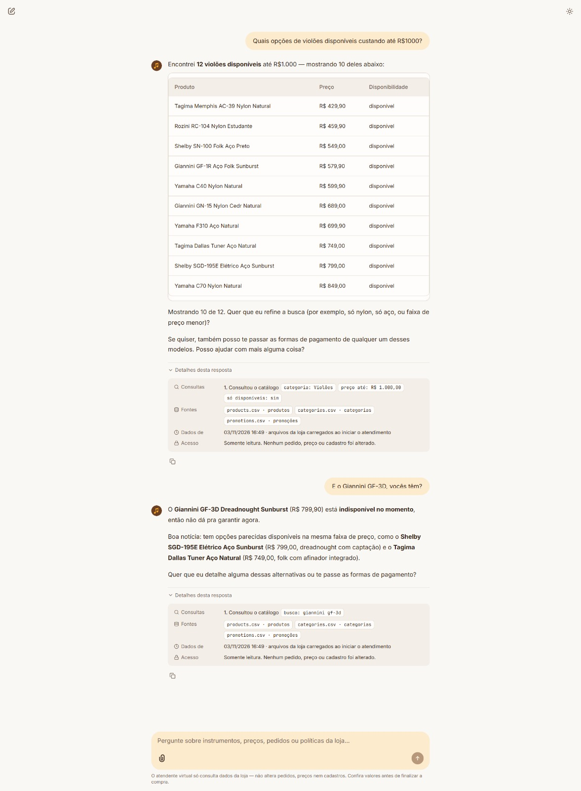

# 02 · Catalog search with filters and an out-of-stock product

| | |
|---|---|
| **Scenario** | A customer asks for acoustic guitars that are available and cost up to R$1,000. Then the customer asks for one specific model that is out of stock. |
| **Tools used** | `search_products(category="Violões", max_price=1000, only_available=true)` → `search_products(query="giannini gf-3d")` |
| **Rules applied** | The list, prices and labels come from the catalog only (manual §7.1). The tool returns at most 10 products plus `total_found: 12`, so the agent shows 10 and says "Mostrando 10 de 12", as the system prompt asks. Stock is shown only as a label (D8-4b). The Giannini GF-3D is `active` with stock 0, so the tool labels it "indisponível no momento". The agent says so and suggests similar models that are available, describing them from the catalog data (D8-7, manual §7.3). |
| **What it shows** | The model turns a natural question into structured filters (category, price, availability), and it handles an unavailable product honestly. |

Recorded in the Chainlit UI on 2026-11-03.

## Conversation (pt-BR, as answered by the agent)

**Cliente:** Quais opções de violões disponíveis custando até R$1000?

**Agente:** Encontrei **12 violões disponíveis** até R$1.000 — mostrando 10 deles abaixo:

| Produto | Preço | Disponibilidade |
|---|---|---|
| Tagima Memphis AC-39 Nylon Natural | R$ 429,90 | disponível |
| Rozini RC-104 Nylon Estudante | R$ 459,90 | disponível |
| Shelby SN-100 Folk Aço Preto | R$ 549,00 | disponível |
| Giannini GF-1R Aço Folk Sunburst | R$ 579,90 | disponível |
| Yamaha C40 Nylon Natural | R$ 599,90 | disponível |
| Giannini GN-15 Nylon Cedr Natural | R$ 689,00 | disponível |
| Yamaha F310 Aço Natural | R$ 699,90 | disponível |
| Tagima Dallas Tuner Aço Natural | R$ 749,00 | disponível |
| Shelby SGD-195E Elétrico Aço Sunburst | R$ 799,00 | disponível |
| Yamaha C70 Nylon Natural | R$ 849,00 | disponível |

Mostrando 10 de 12. Quer que eu refine a busca (por exemplo, só nylon, só aço, ou faixa de preço menor)?

Se quiser, também posso te passar as formas de pagamento de qualquer um desses modelos. Posso ajudar com mais alguma coisa?

> 🔎 Consultou o catálogo · `categoria: Violões` · `preço até: R$ 1.000,00` · `só disponíveis: sim` · fontes: `products.csv`, `categories.csv`, `promotions.csv`

**Cliente:** E o Giannini GF-3D, vocês têm?

**Agente:** O **Giannini GF-3D Dreadnought Sunburst** (R$ 799,90) está **indisponível no momento**, então não dá pra garantir agora.

Boa notícia: tem opções parecidas disponíveis na mesma faixa de preço, como o **Shelby SGD-195E Elétrico Aço Sunburst** (R$ 799,00, dreadnought com captação) e o **Tagima Dallas Tuner Aço Natural** (R$ 749,00, folk com afinador integrado).

Quer que eu detalhe alguma dessas alternativas ou te passe as formas de pagamento?

> 🔎 Consultou o catálogo · `busca: giannini gf-3d` · fontes: `products.csv`, `categories.csv`, `promotions.csv`
