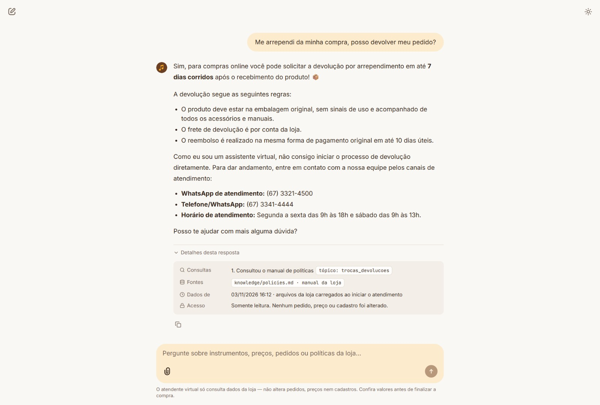

# 03 · Return after regret (store policy)

| | |
|---|---|
| **Scenario** | A customer regrets a purchase and asks whether the order can be returned. |
| **Tools used** | `get_store_policy(topic="trocas_devolucoes")` |
| **Rules applied** | The agent answers store rules only from the policy manual, never from memory (D3). Everything in the answer matches manual §4.1: 7 calendar days after delivery, original packaging and no signs of use, return shipping paid by the store, refund within 10 business days with the original payment method. The agent only reads data, so it does not claim to start the return. It points to the team's two channels and their hours (manual §7, D8-1). |
| **What it shows** | The agent knows when to consult the **policies** instead of the data, and it is honest about what it cannot do. |

Recorded in the Chainlit UI on 2026-11-03.

## Conversation (pt-BR, as answered by the agent)

**Cliente:** Me arrependi da minha compra, posso devolver meu pedido?

**Agente:** Sim, para compras online você pode solicitar a devolução por arrependimento em até **7 dias corridos** após o recebimento do produto! 📦

A devolução segue as seguintes regras:

- O produto deve estar na embalagem original, sem sinais de uso e acompanhado de todos os acessórios e manuais.
- O frete de devolução é por conta da loja.
- O reembolso é realizado na mesma forma de pagamento original em até 10 dias úteis.

Como eu sou um assistente virtual, não consigo iniciar o processo de devolução diretamente. Para dar andamento, entre em contato com a nossa equipe pelos canais de atendimento:

- **WhatsApp de atendimento:** (67) 3321-4500
- **Telefone/WhatsApp:** (67) 3341-4444
- **Horário de atendimento:** Segunda a sexta das 9h às 18h e sábado das 9h às 13h.

Posso te ajudar com mais alguma dúvida?

> 🔎 Consultou o manual de políticas · `tópico: trocas_devolucoes` · fonte: `knowledge/policies.md`
