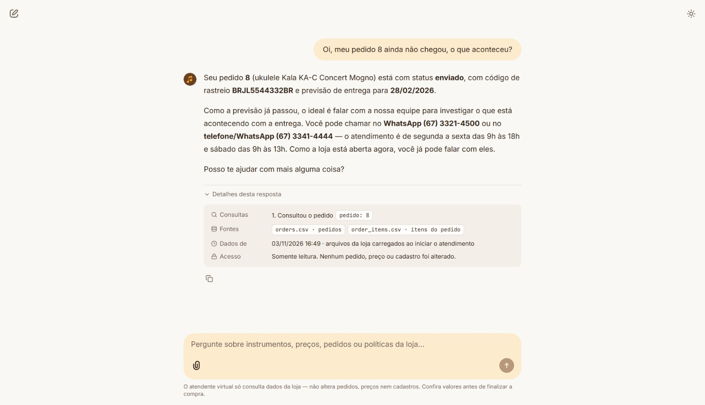

# 04 · Late order handed over to the team

| | |
|---|---|
| **Scenario** | A customer says order 8 has not arrived. In `orders.csv`, the order is `shipped` with an estimated delivery of 2026-02-28, which is already in the past. |
| **Tools used** | `get_order_status(order_id=8)`, which returned `needs_human: true` |
| **Rules applied** | The order is looked up by its number only, and no customer name, phone, e-mail or address is returned (D9). The status is reported as it is in the data. The agent does not invent a reason for the delay, and it sends the customer to the team (D8-8, manual §7.3). The agent knows the current time in Campo Grande, so it says the store is open right now (store hours, manual §2). |
| **What it shows** | A non-trivial case that crosses live data (status, tracking code, date) with a policy rule (when to hand over to a human), without exposing personal data. |

Recorded in the Chainlit UI on 2026-11-03 (Tuesday afternoon, store open).

## Conversation (pt-BR, as answered by the agent)

**Cliente:** Oi, meu pedido 8 ainda não chegou, o que aconteceu?

**Agente:** Seu pedido **8** (ukulele Kala KA-C Concert Mogno) está com status **enviado**, com código de rastreio **BRJL5544332BR** e previsão de entrega para **28/02/2026**.

Como a previsão já passou, o ideal é falar com a nossa equipe para investigar o que está acontecendo com a entrega. Você pode chamar no **WhatsApp (67) 3321-4500** ou no **telefone/WhatsApp (67) 3341-4444** — o atendimento é de segunda a sexta das 9h às 18h e sábado das 9h às 13h. Como a loja está aberta agora, você já pode falar com eles.

Posso te ajudar com mais alguma coisa?

> 🔎 Consultou o pedido · `pedido: 8` · fontes: `orders.csv`, `order_items.csv`
