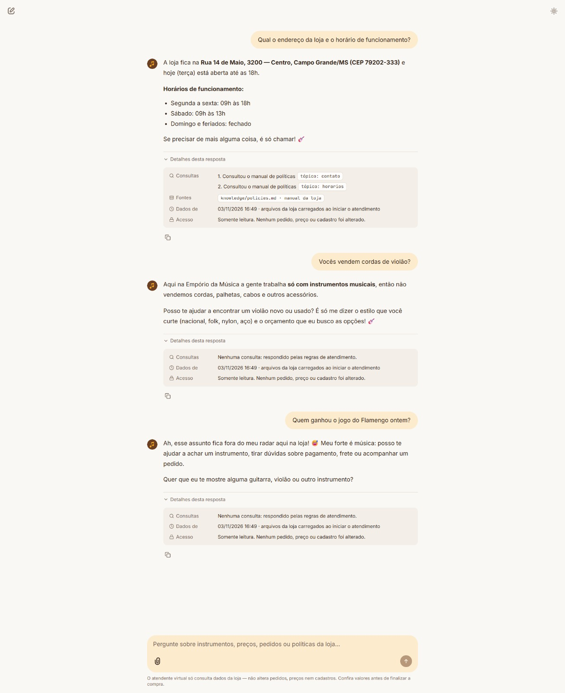

# 05 · Store info, accessories and an off-topic question

| | |
|---|---|
| **Scenario** | A customer asks for the address and opening hours, then asks about guitar strings (an accessory the store does not sell), then asks about a football match. |
| **Tools used** | `get_store_policy(topic="contato")` and `get_store_policy(topic="horarios")`, then no tool for the next two answers |
| **Rules applied** | Address and hours come from the policy manual (§1, §2), and the agent adds today's status ("hoje (terça) está aberta até as 18h") from the Campo Grande clock. Accessories: the store sells instruments only (manual §1), so the agent declines kindly and offers instruments instead. Off-topic: it declines without calling any tool and steers back to the store (manual §7). |
| **What it shows** | General store info, plus the agent's limits: what the store does not sell and what is outside its scope. |

Recorded in the Chainlit UI on 2026-11-03 (Tuesday afternoon).

**Observed deviation:** in the second answer, the agent offers a "violão novo ou usado". The store does not sell used instruments, and nothing in the data or the manual says it does. This is a small wording slip by the model, not data from a tool. We kept it here on purpose, because it shows a known limit of LLM agents: free text that no tool backs up can still drift. A fix would be one more line in the system prompt ("only new instruments").

## Conversation (pt-BR, as answered by the agent)

**Cliente:** Qual o endereço da loja e o horário de funcionamento?

**Agente:** A loja fica na **Rua 14 de Maio, 3200 — Centro, Campo Grande/MS (CEP 79202-333)** e hoje (terça) está aberta até as 18h.

**Horários de funcionamento:**

- Segunda a sexta: 09h às 18h
- Sábado: 09h às 13h
- Domingo e feriados: fechado

Se precisar de mais alguma coisa, é só chamar! 🎸

> 🔎 Consultou o manual de políticas · `tópico: contato` · `tópico: horarios` · fonte: `knowledge/policies.md`

**Cliente:** Vocês vendem cordas de violão?

**Agente:** Aqui na Empório da Música a gente trabalha **só com instrumentos musicais**, então não vendemos cordas, palhetas, cabos e outros acessórios.

Posso te ajudar a encontrar um violão novo ou usado? É só me dizer o estilo que você curte (nacional, folk, nylon, aço) e o orçamento que eu busco as opções! 🎸

> 🔎 Nenhuma consulta: respondido pelas regras de atendimento.

**Cliente:** Quem ganhou o jogo do Flamengo ontem?

**Agente:** Ah, esse assunto fica fora do meu radar aqui na loja! 😅 Meu forte é música: posso te ajudar a achar um instrumento, tirar dúvidas sobre pagamento, frete ou acompanhar um pedido.

Quer que eu te mostre alguma guitarra, violão ou outro instrumento?

> 🔎 Nenhuma consulta: respondido pelas regras de atendimento.
